# AWS Lab: Auditing an Incident with AWS CloudTrail and Athena

Hands-on lab completed on **16 Nov 2026** (us-west-2, with some logs in us-east-1). Scenario: a cafe's website was defaced and someone opened SSH to the world on its security group. I enabled CloudTrail, then investigated with `grep`, the AWS CLI and Amazon Athena, and finally cleaned up the instance and the AWS account.

> Screenshots have been redacted (account IDs, resource IDs, IP addresses, ARNs, bucket names and usernames are blurred). The original lab guide is AWS training material and is not reproduced here; this repo contains my own notes and queries.

## Summary

| Phase | What I did |
|-------|-----------|
| Baseline | Added an SSH rule limited to my own IP and checked the website looked normal |
| Detection | Created the `monitor` trail (multi-region, KMS-encrypted S3 bucket); the site was then defaced and a world-open SSH rule appeared |
| Investigation | Downloaded the logs and searched them with `grep`, `aws cloudtrail lookup-events`, then Athena SQL |
| Response | Found an unexpected `chaos-user` OS login, killed the session, removed the account, hardened `sshd_config`, removed the open SSH rule, restored the image, deleted the `chaos` IAM user |

Reusable material: [`queries/athena-queries.sql`](queries/athena-queries.sql) and [`commands/investigation-commands.md`](commands/investigation-commands.md).

## Walkthrough

### 1. Baseline and trail creation

**Cafe Web Server instance and its security group**

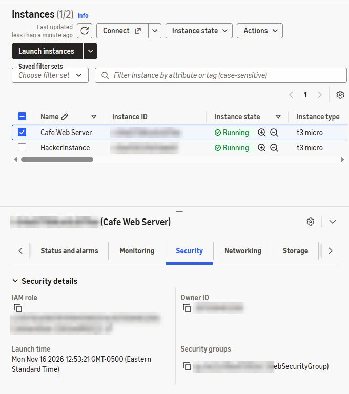

**Adding an SSH rule restricted to my own IP (/32)**

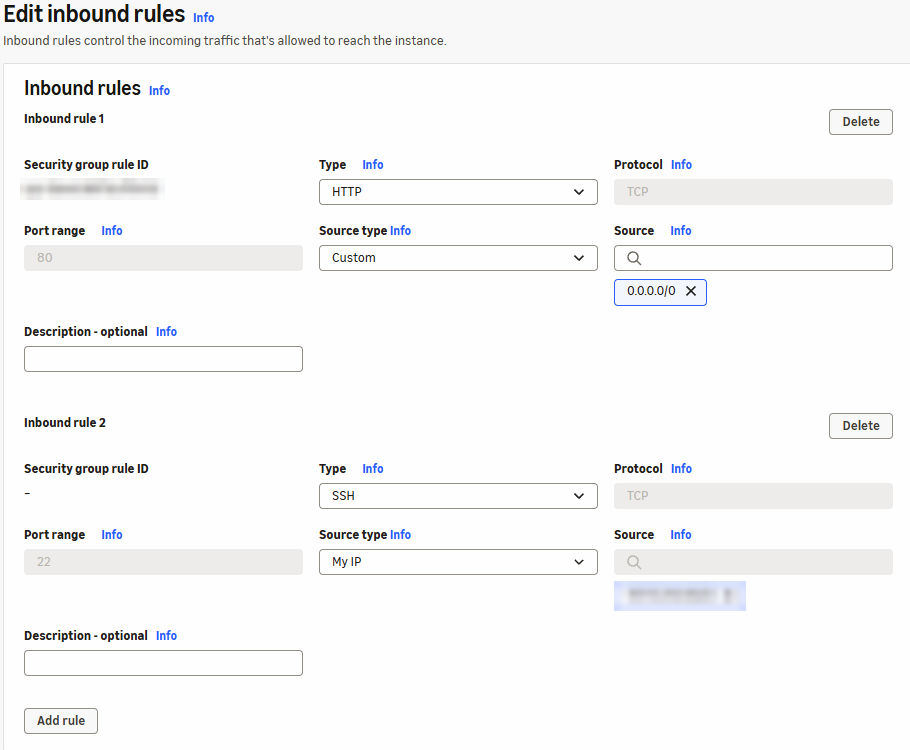

**Cafe website before the incident**

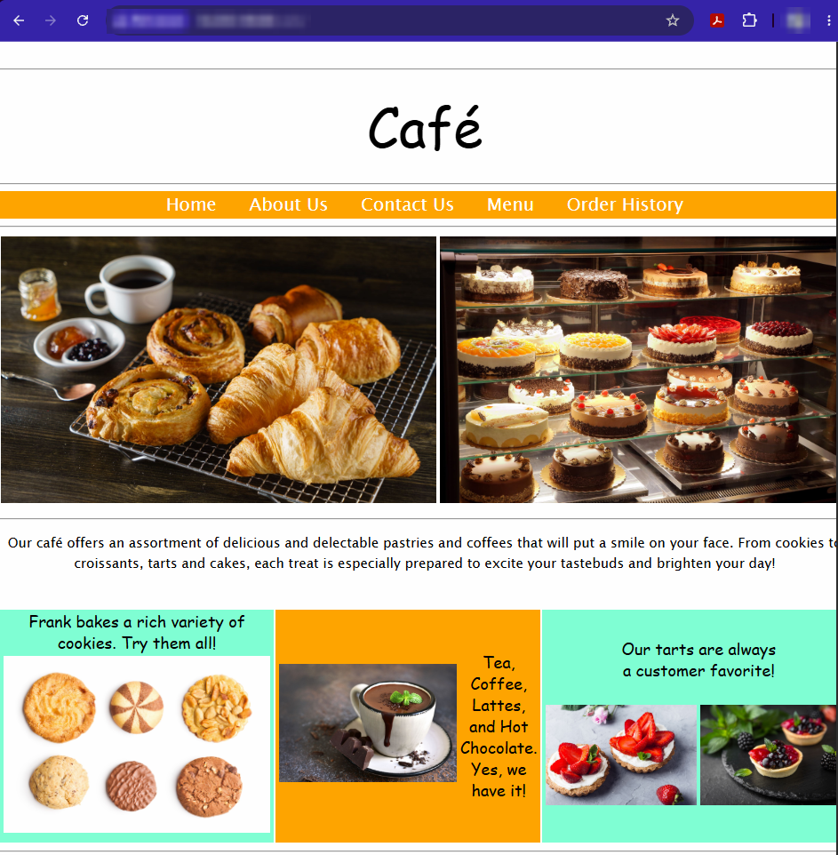

**Creating the `monitor` trail with a new S3 bucket and KMS alias**


**Trail created (multi-region, us-west-2 home)**

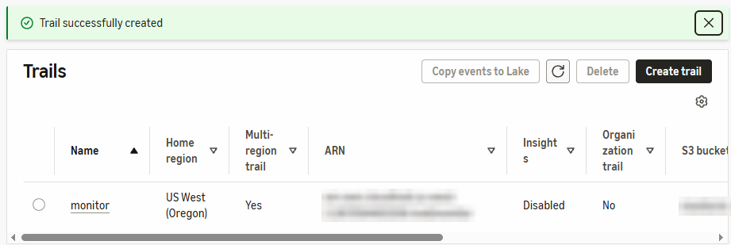


### 2. The incident

**Cafe website after the incident (defaced image)**

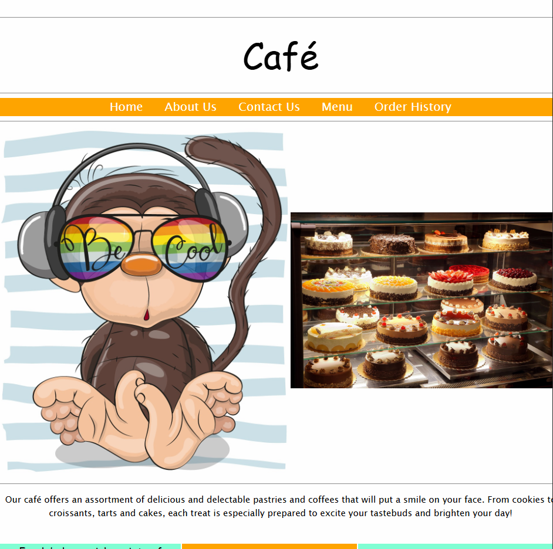

**Security group now has an extra SSH rule open to 0.0.0.0/0**

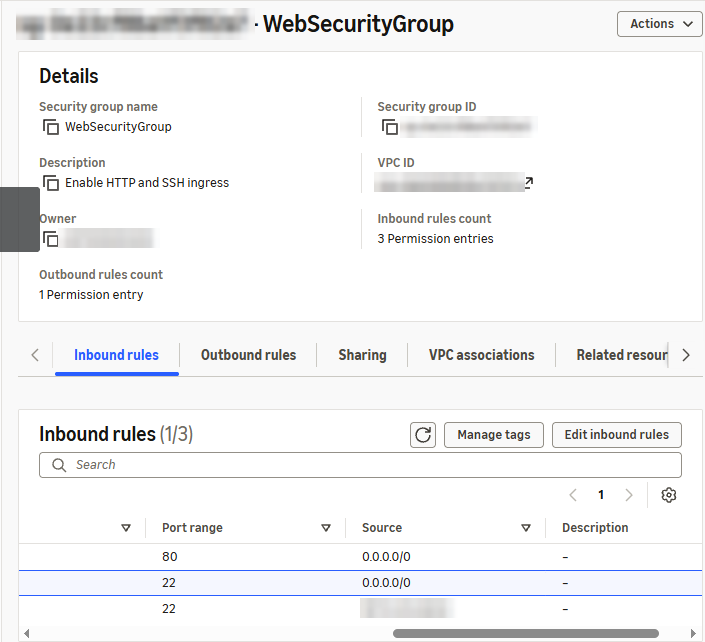


### 3. Investigating with grep and the AWS CLI

Connected over SSH, downloaded and unzipped the logs, then filtered them.

**SSH session on the web server**

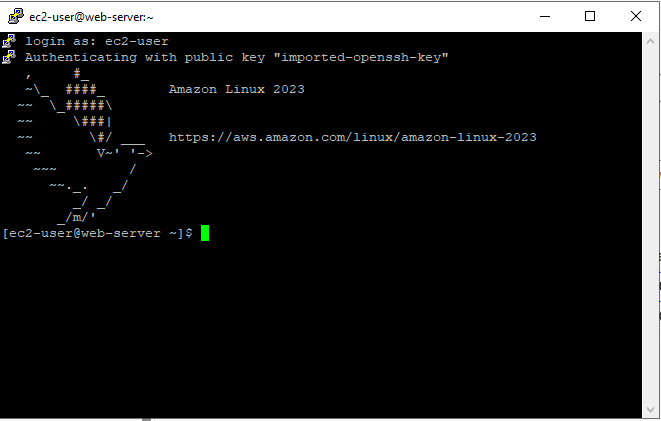

**Downloading the CloudTrail logs with `aws s3 cp` (first attempt had a bucket-name typo)**


**Navigating the downloaded log directory**

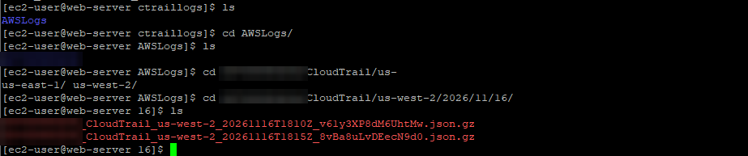

**Filtering log files for `sourceIPAddress`**


**Listing every `eventName` across the log files**


**Logs in the us-east-1 directory**

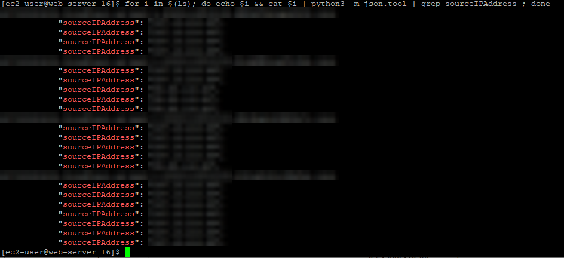

**Setting the region manually and retrieving the security group ID**

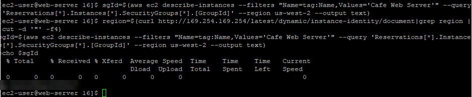

**`aws cloudtrail lookup-events` filtered by security group (fully blurred: raw JSON is full of IDs and keys)**


### 4. Investigating with Athena

**Athena editor and the new table**

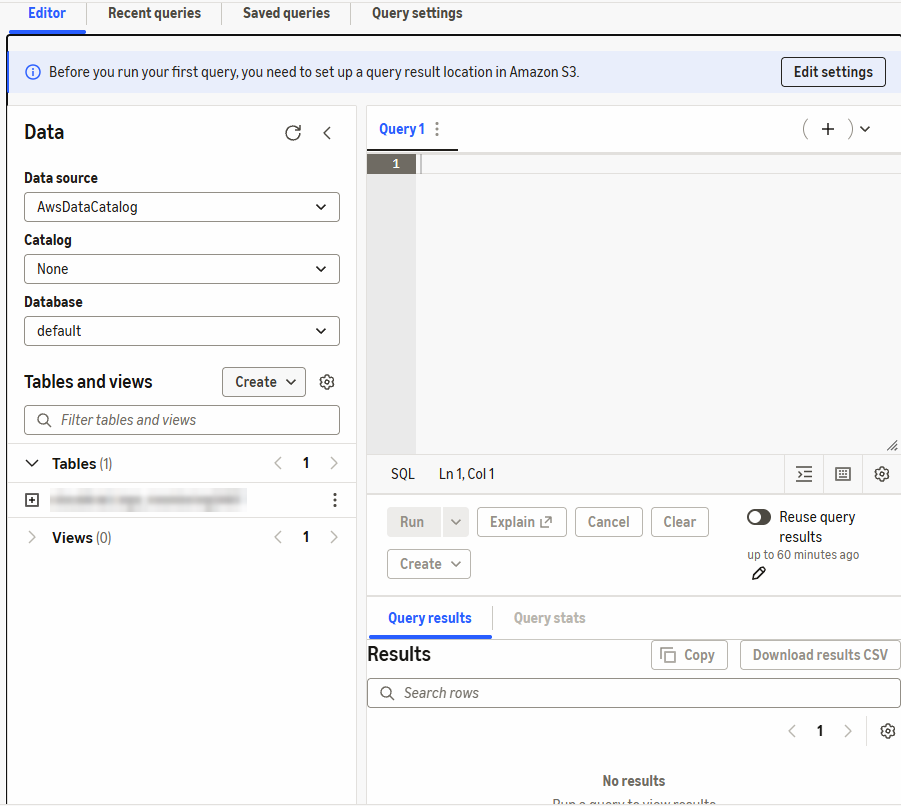

**Setting the Athena query result location**

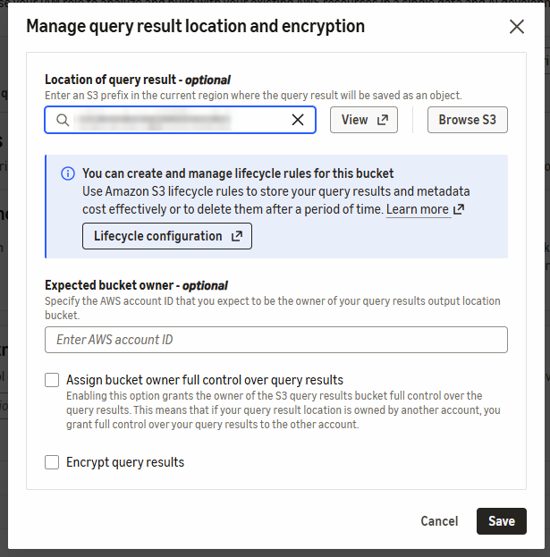

**Creating the Athena table from CloudTrail event history**

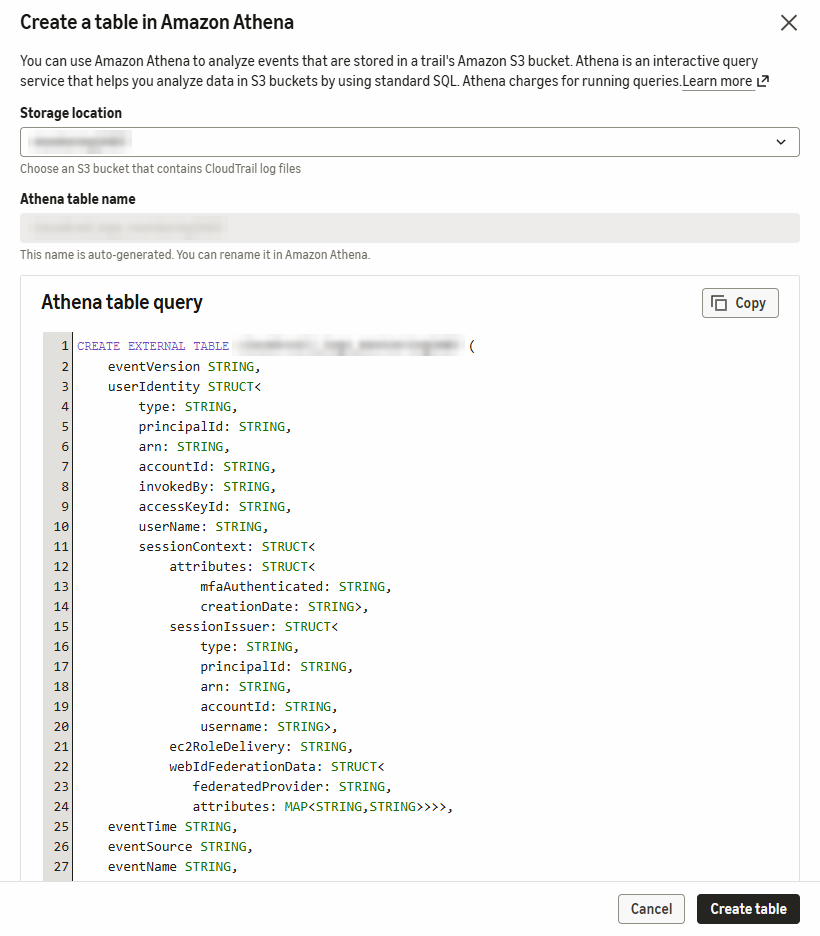

**First query: `SELECT * ... LIMIT 5`**


**Narrowed query on user, time, source, event name and parameters**

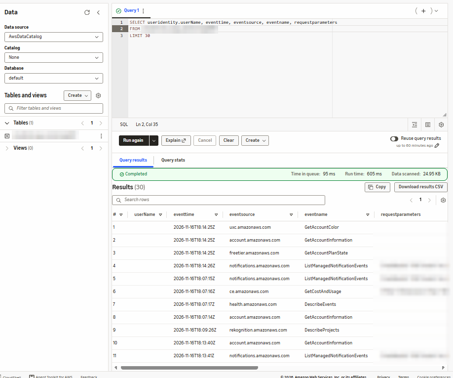

**Filtering EC2 events whose name contains `Security`**


### 5. Response and hardening

**`aureport --auth` shows an unexpected `chaos-user` login**


**Killing the session and deleting the `chaos-user` OS account**


**Checking `/etc/passwd` for other login-capable users**


**Reviewing `sshd_config`**


**Editing the inbound rules to remove the world-open SSH rule**

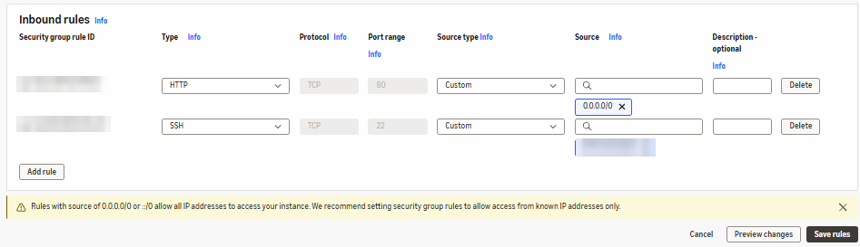

**Cafe website restored**


**Deleting the `chaos` IAM user**


## Challenge findings

Fill these in from your own Athena results before publishing (I did not redact-and-copy them from the lab):

- IAM user who changed the security group: `<fill in>`
- Time of the change (UTC): `<fill in>`
- Source IP: `[redacted]`
- Method (console or programmatic): `<fill in>`

## Troubleshooting and lessons learned

- **Wrong region gave empty CLI results.** The default region variable was not set, so the `lookup-events` and `describe-instances` commands returned nothing. Hard-coding `--region us-west-2` fixed it. I also found log files under `us-east-1`, since the trail is multi-region.
- **Typo in the bucket name** caused a `NoSuchBucket` error on the first `aws s3 cp`; the table name in Athena inherits that spelling.
- **Athena query result location** moved in the console: *Query editor > Query settings > Manage*.
- Searches for security group rules by an unfamiliar principal were the strongest lead; querying `eventname LIKE '%Security%'` on `ec2.amazonaws.com` narrowed the results quickly.
- Defense in depth: restricting SSH to a /32, disabling password auth, deleting stale IAM users and keeping CloudTrail on all matter together.

## Repo layout

```
.
├── README.md
├── commands/investigation-commands.md
├── queries/athena-queries.sql
└── images/            # redacted screenshots, numbered in walkthrough order
```
